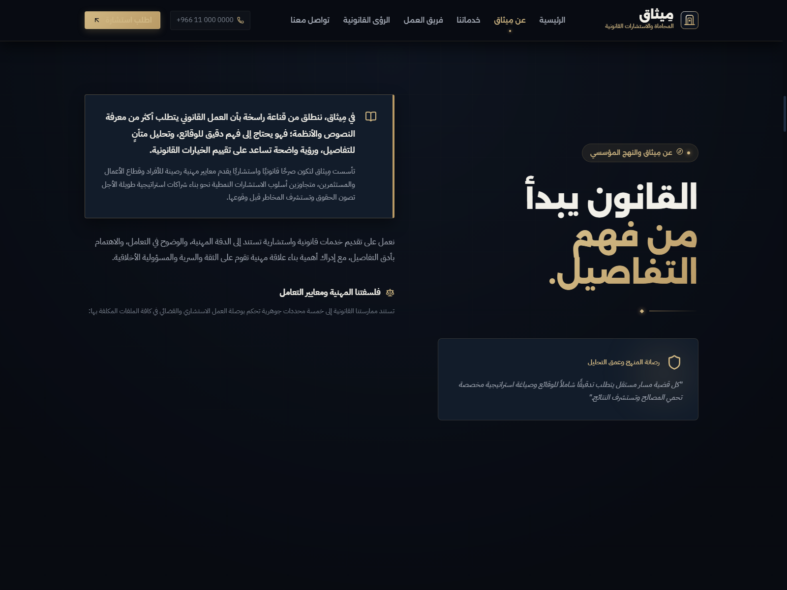
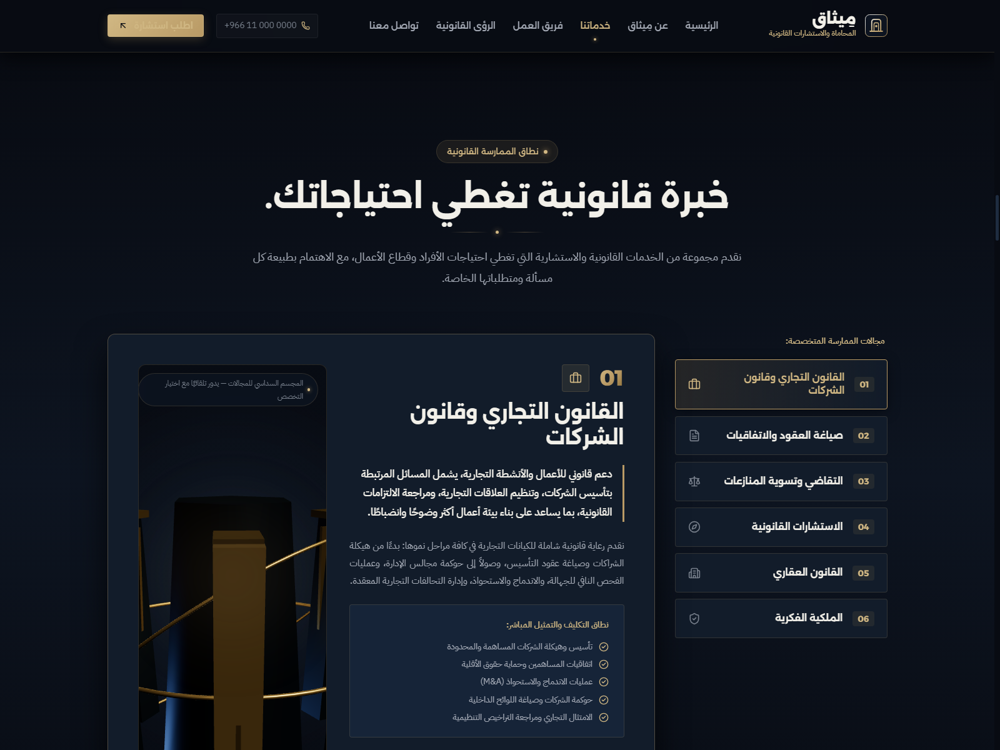
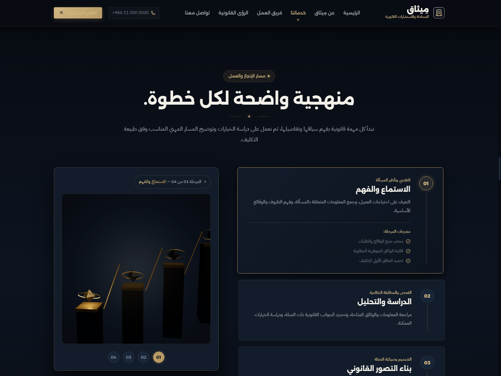
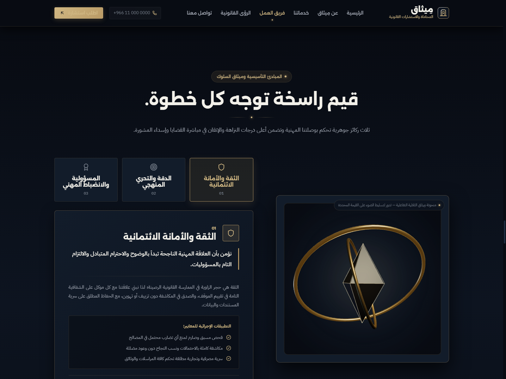

<h1 align="center">مِيثاق | MITHAQ</h1>

<h3 align="center">Legal Practice & Consultancy Website Concept</h3>

<p align="center">
  An Arabic-first, right-to-left website concept for a premium legal practice, combining institutional positioning, structured legal service presentation, interactive 3D visuals, and motion-led storytelling.
</p>

<p align="center">
  <a href="https://the-legal-profession.vercel.app/">
    
  </a>
  
  
  
  
  
</p>

<p align="center">
  <strong><a href="https://the-legal-profession.vercel.app/">Explore the Live Experience →</a></strong>
</p>

---

## Table of Contents

- [Project Overview](#project-overview)
- [Project Scope & Disclaimer](#project-scope--disclaimer)
- [Visual Preview](#visual-preview)
- [Key Features](#key-features)
- [Design Direction](#design-direction)
- [Technology Stack](#technology-stack)
- [Application Structure](#application-structure)
- [Getting Started](#getting-started)
- [Available Scripts](#available-scripts)
- [Content Management](#content-management)
- [3D & Animation Implementation](#3d--animation-implementation)
- [Contact & Demo Interactions](#contact--demo-interactions)
- [Deployment](#deployment)
- [Troubleshooting](#troubleshooting)
- [Author](#author)

---

## Project Overview

**مِيثاق (Mithaq)** is an independent website concept created to demonstrate how a premium legal practice could present its identity, expertise, services, and client experience through a carefully art-directed digital platform.

The experience is built around a clear institutional narrative: understanding the legal context, presenting specialized practice areas, explaining the working methodology, and making consultation pathways easy to discover.

The website is Arabic-first and uses a complete **RTL (right-to-left)** layout. Its visual language combines a deep navy interface, restrained gold accents, architectural visual elements, Arabic editorial typography, custom 3D scenes, and scroll-driven motion.

**Live website:** https://the-legal-profession.vercel.app/  
**Repository:** https://github.com/ahsanelm39-star/The-Legal-Profession

## Project Scope & Disclaimer

This repository contains a **self-initiated portfolio concept**, not the operational website of a verified law firm.

The brand identity, firm profile, team member names and biographies, office details, phone number, email address, service descriptions, articles, and other institutional claims shown in the experience are illustrative demo content created for the concept. They must not be interpreted as verified information about a real legal practice or real legal professionals.

The website is a front-end demonstration and does not provide legal advice, establish an attorney-client relationship, or represent an actual legal service provider.

---

## Visual Preview

The repository includes the following project screenshots:

<p align="center">
  
  
</p>

<p align="center">
  
  
</p>

Additional section captures are available in the repository root, including positioning, team, FAQ, and differentiation views.

---

## Key Features

### Institutional Presentation

- Arabic-first landing-page experience with RTL layout.
- Branded header, section navigation, and footer.
- Active-section navigation state while scrolling.
- Institutional positioning and firm introduction.
- Dedicated presentation of values, working principles, and team profiles.

### Legal Practice Areas

- Interactive selector for **six legal practice areas**:
  - Commercial & Corporate Law
  - Contract Drafting & Agreements
  - Litigation & Dispute Resolution
  - Legal Consultancy
  - Real Estate Law
  - Intellectual Property
- Dynamic service details and key service lists.
- A dedicated 3D visual that responds to the selected practice area.
- Responsive presentation for desktop and smaller screens.

### Methodology & Trust Content

- Structured, four-stage legal workflow: listening and understanding, study and analysis, legal planning, and professional follow-through.
- Differentiation section explaining the concept's professional approach.
- Interactive values presentation supported by a 3D visual.
- Team profiles with role, specialization, biography, and focus areas.

### Legal Insights & FAQ

- Editorial legal-insights layout with a featured article and supporting articles.
- Article detail modal for reading the full sample article content.
- FAQ categories and accordion interactions.

### Consultation & Contact UI

- Consultation modal with meeting-type and inquiry-topic selections.
- Contact section with phone, email, and location display.
- Copy-to-clipboard actions for contact details.
- Client-side form validation and submission-state feedback.

> **Important:** The consultation and contact experiences are front-end demo interactions only. They do not currently submit data to a backend, send emails, store inquiries, or create real appointments. See [Contact & Demo Interactions](#contact--demo-interactions).

---

## Design Direction

The visual system is designed to communicate formality, precision, and confidence without relying on generic legal-industry templates.

- **Palette:** deep navy and graphite surfaces with muted bronze/gold accents.
- **Typography:** IBM Plex Sans Arabic and Alexandria, loaded through Google Fonts.
- **Composition:** editorial layouts, asymmetrical content blocks, structured cards, and generous spacing.
- **Visual language:** architectural geometry, sculptural 3D objects, subtle lighting, and restrained atmospheric effects.
- **Motion:** sequenced hero reveals, scroll-triggered section animations, and interactive visual states.

The page is composed as a single scrolling experience with anchor-based navigation rather than a multi-route application.

---

## Technology Stack

The stack below is based on the repository's current `package.json` and source imports.

| Area | Technology | Role |
|---|---|---|
| UI | React 19 | Component-based interface |
| Language | TypeScript | Typed application code |
| Build tool | Vite 8 | Development server and production bundling |
| 3D rendering | Three.js | Custom WebGL scenes and 3D visuals |
| Animation | GSAP | Timelines and interface motion |
| Scroll animation | GSAP ScrollTrigger | Scroll-based reveals and sequences |
| Icons | Lucide React | Interface icons |
| Styling | CSS | Global styles and component-level styling |
| Typography | IBM Plex Sans Arabic, Alexandria | Arabic interface typography |
| Linting | Oxlint | Static code linting |

The 3D experiences use **Three.js directly**; React Three Fiber and Drei are not part of the current dependency stack.

---

## Application Structure

The following is a high-level map of the current source organization:

```text
The-Legal-Profession/
├── public/                         # Public static assets
├── src/
│   ├── components/
│   │   ├── layout/                  # Header and footer
│   │   ├── sections/                # Homepage sections
│   │   ├── three/                   # Three.js scenes and fallback visual
│   │   └── ui/                      # Shared UI and modal components
│   ├── constants/
│   │   └── content.ts               # Brand, services, team, articles, FAQ content
│   ├── styles/
│   │   ├── global.css               # Global reset and base styles
│   │   └── variables.css            # Design tokens and CSS variables
│   ├── types/
│   │   └── index.ts                 # Shared TypeScript interfaces
│   ├── App.tsx                      # Main single-page composition and modal state
│   └── main.tsx                     # React application entry point
├── shot-about.png                  # Project screenshots
├── shot-services.png
├── shot-methodology.png
├── shot-insights.png
├── index.html                      # HTML entry and metadata
├── package.json                    # Dependencies and scripts
├── package-lock.json
├── vite.config.ts
├── tsconfig.json
├── tsconfig.app.json
├── tsconfig.node.json
└── .oxlintrc.json
```

### Main Page Sections

The application composes the following sections in `src/App.tsx`:

1. Header & Navigation
2. Hero with 3D experience
3. Institutional Positioning
4. About the Firm
5. Practice Areas
6. Why Choose Us
7. Working Methodology
8. Legal Team
9. Institutional Values
10. Legal Insights
11. FAQ
12. Final Call to Action
13. Contact
14. Footer

The consultation and article-reading interfaces are presented through reusable modal components.

---

## Getting Started

### Prerequisites

- Node.js **20.19+** or **22.12+**.
- npm (the repository includes `package-lock.json`).
- A modern browser with WebGL support for the full 3D experience.

The Node.js requirement follows the current Vite 8 compatibility guidance: https://vite.dev/guide/.

### 1. Clone the repository

```bash
git clone https://github.com/ahsanelm39-star/The-Legal-Profession.git
cd The-Legal-Profession
```

### 2. Install dependencies

```bash
npm install
```

### 3. Start the development server

```bash
npm run dev
```

Vite will print the local development URL in the terminal (by default, `http://localhost:5173`).

### 4. Create a production build

```bash
npm run build
```

The build script runs TypeScript project checks first, then creates the optimized Vite production output in `dist/`.

---

## Available Scripts

| Command | Description |
|---|---|
| `npm run dev` | Starts the Vite development server. |
| `npm run build` | Runs `tsc -b` followed by `vite build`. |
| `npm run lint` | Runs Oxlint against the project. |
| `npm run preview` | Serves the production build locally for preview. |

There is no separate `typecheck` script in the current `package.json`; TypeScript project checking is part of the production build command.

---

## Content Management

Most of the website's displayed content is centralized in:

```text
src/constants/content.ts
```

This file contains the brand information, navigation items, positioning statements, about content, practice areas, differentiators, methodology stages, team profiles, values, legal insight articles, FAQ content, and other section data.

To update the concept's written content:

1. Locate the relevant content constant in `src/constants/content.ts`.
2. Update the corresponding text or data entry.
3. Preserve the existing object shape and required fields.
4. If a data structure changes, update its TypeScript interface in `src/types/index.ts`.
5. Run `npm run build` and `npm run lint` before committing.

### Static Assets

Place files intended to be served directly by the application in `public/`, then reference them using root-relative paths. Keep large images optimized for web delivery.

### UI Components

Shared layout, section, 3D, and interface components are organized under `src/components/`. Prefer updating the relevant component rather than duplicating shared behavior.

---

## 3D & Animation Implementation

The project contains dedicated Three.js scene components for the main visual experiences:

- `Hero3DScene.tsx` — architectural hero scene.
- `Services3DScene.tsx` — visual that responds to the selected practice area.
- `Methodology3DScene.tsx` — 3D visual accompanying the methodology timeline.
- `Values3DScene.tsx` — 3D composition accompanying the values section.
- `ThreeFallback.tsx` — SVG fallback visual used when WebGL is unavailable in the hero experience.

GSAP is used for entrance timelines and component-level motion. ScrollTrigger is registered for scroll-based section reveals and animations.

When extending these scenes:

- Dispose of geometries, materials, renderers, and event listeners during cleanup.
- Keep rendering work proportional to the visible scene.
- Check container dimensions when handling responsive layouts.
- Avoid creating duplicate animation loops or ScrollTrigger instances.
- Respect reduced-motion preferences where adding new motion behavior.
- Preserve a usable non-WebGL fallback for the hero visual.

---

## Contact & Demo Interactions

The current contact experience is intentionally front-end only.

- The contact form validates required fields and then simulates a successful submission locally.
- The consultation modal stores its selections in component state and displays a local confirmation state.
- No backend endpoint, email provider, CRM, database, or appointment service is configured in this repository.
- The displayed phone number, email address, and office address are illustrative concept details, not verified contact channels.

Before adapting this concept for a real law firm, replace all demo identity and contact information, review all legal copy with qualified professionals, and connect the forms to a secure, tested backend or approved form-processing service. Do not present the current demo submission state as a real inquiry delivery flow.

---

## Deployment

The live demonstration is hosted on Vercel:

https://the-legal-profession.vercel.app/

For a new Vercel deployment:

1. Import the GitHub repository into Vercel.
2. Select the Vite framework preset if it is not detected automatically.
3. Use the following build settings:
   - **Build command:** `npm run build`
   - **Output directory:** `dist`
   - **Install command:** `npm install`
4. Deploy the project.
5. Test the deployed experience, including the 3D visuals, responsive navigation, modal interactions, and contact demo states.

No environment variables are currently required by the front-end implementation in this repository. If a real backend or third-party integration is added, document its required variables in an `.env.example` file and configure the values securely in the deployment environment. Never commit secrets.

---

## Troubleshooting

### Vite reports an unsupported Node.js version

Use Node.js 20.19+ or 22.12+ and reinstall dependencies if necessary.

### Dependencies are missing

Run:

```bash
npm install
```

### The 3D hero does not render

Check browser WebGL support and the browser console. The hero includes a fallback visual for environments where WebGL is unavailable. Other 3D sections may require a supported browser/device for their full experience.

### The production build fails

Run the checks separately to narrow down the cause:

```bash
npm run lint
npm run build
```

Review TypeScript diagnostics and Oxlint output before changing application code.

### Contact form submissions do not arrive anywhere

This is expected in the current concept. The form only simulates a client-side confirmation and is not connected to a backend or email service.

---

## Author

**Ahmed Mohamed Hasan**  
Website Designer & Developer

- **Portfolio:** https://ahmed-web-designer-developer.vercel.app/
- **GitHub:** https://github.com/ahsanelm39-star
- **LinkedIn:** https://www.linkedin.com/in/ahmed-mohame-843909439/
- **Email:** ah.dev.3@gmail.com

---

<p align="center">
  <sub>Independent concept designed and developed by Ahmed Mohamed Hasan.</sub>
</p>
